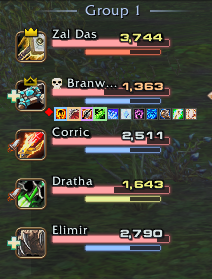
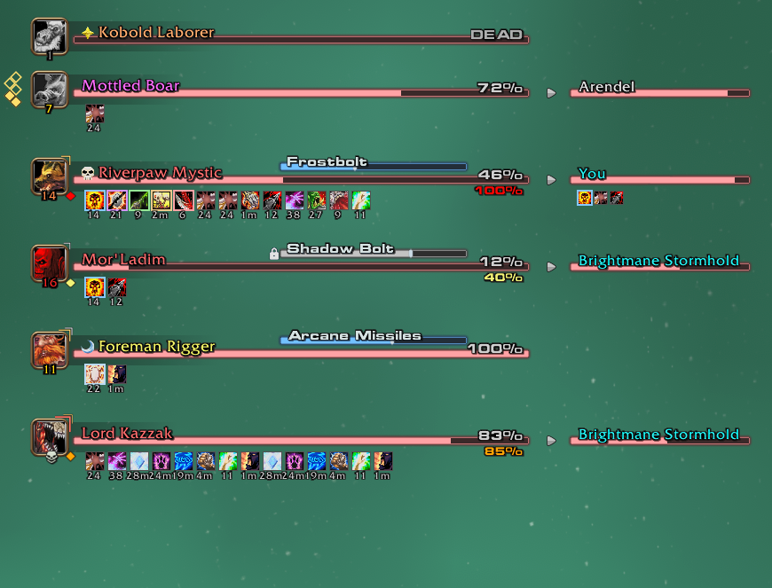
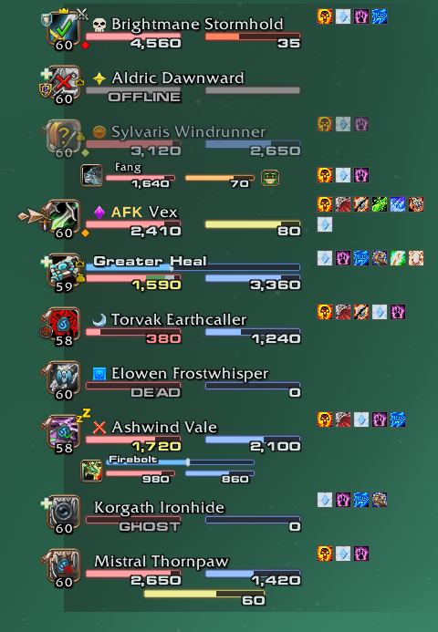
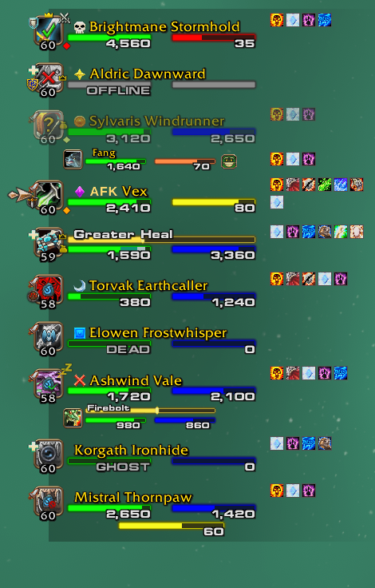
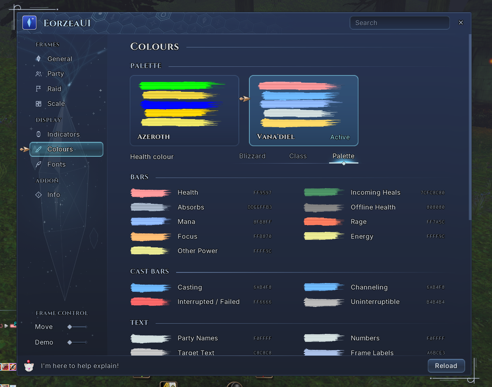

# EorzeaUI

Final Fantasy–style unit frames for **WoW Forever**: a party list, target bars with target-of-target, cast bars and raid groups, modelled on the VanaVista HUD for FFXI.

## Features

<table align="right"><tr><td align="center"> Raid frame</td></tr></table>

- **Party list.** You and up to four party members, with HP and mana numbers, pets, cast bars, buffs and debuffs, and status: offline, dead, ghost, AFK, DND, out of range.
- **Target, focus and boss bars.** HP percent, cast bar (with a lock on uninterruptible casts), auras with timers, raid markers, and the unit's own target beside it.
- **Raid frames.** Eight compact group blocks, laid out by raid size.
- **Two palettes.** Vana'diel and Azeroth, and you can change any individual colour.
- **Settings window.** Scale per frame, fonts, layout, indicators and colours, all in one place.
- **Moves with Edit Mode.** Opening Blizzard's Edit Mode unlocks EorzeaUI's frames for dragging, or use `/ffui unlock`.

 

 Example target frames

## Palettes

| Vana'diel | Azeroth |
|:---:|:---:|
|  |  |
| VanaVista's colours: pastel red HP, pale blue casts, FFXI name colours. | Blizzard's colours: green HP, gold casts, reaction-coloured names. |

## Settings

Open with `/ffui` or the minimap button. Pick a palette, colour health bars by palette, class or Blizzard's defaults, and change any colour, font, scale or layout.

## Install

Download the latest release, unzip it, and drop the `EorzeaUI` folder into `World of Warcraft\_forever_\Interface\AddOns\`.

## Commands

| Command | What it does |
|---|---|
| `/ffui` | Open the settings |
| `/ffui demo` | Fill every frame with sample units |
| `/ffui unlock` / `/ffui lock` | Show or hide drag handles |
| `/ffui reset` | Put every frame back at its default spot |
| `/ffui scale <n>` | Set the global scale |
| `/ffui style <name>` | Switch palette and reload |
| `/ffui log` | List missing game functions, failed reads and blocked actions |

## Limits on Forever

Forever hides most unit data from addons, even out of combat. EorzeaUI works within that, so a few things are not possible: exact range in yards, custom aura sort order, and remaining-time text on cast bars.

## License

MIT; see [LICENSE](LICENSE). Bundled fonts and libraries keep their own licences.

A fan-made love letter to Final Fantasy menus; not affiliated with Blizzard Entertainment or Square Enix.
